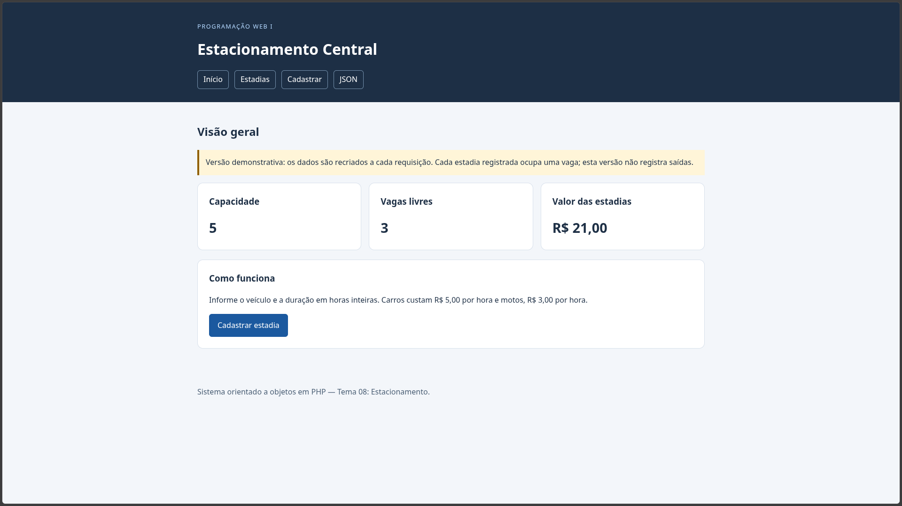
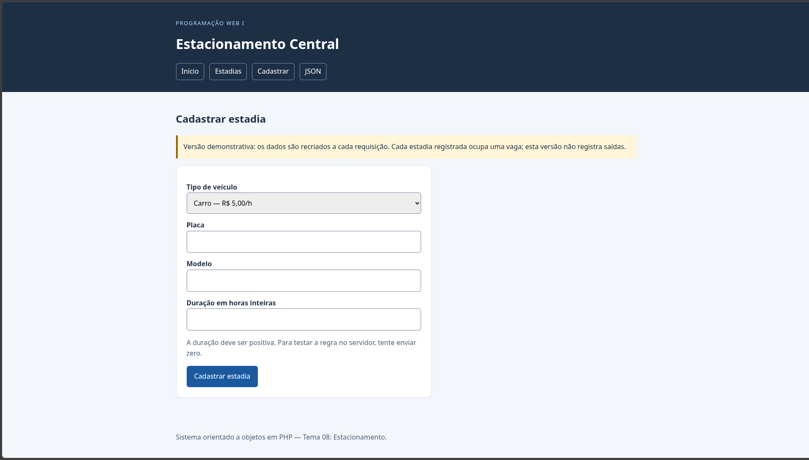
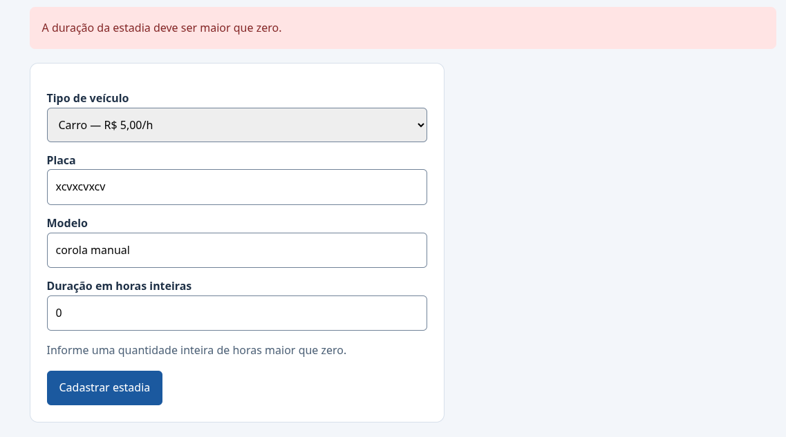

# Estacionamento Central

**Vídeo:** PENDENTE — inserir o link antes da entrega.

**Autor:** Luiz Henrique de Sousa Vieira  
**Disciplina:** Programação Web I  
**Instituição:** IFCE — Campus Boa Viagem  
**Tema:** 08 — Estacionamento

## Apresentação

O Estacionamento Central é um sistema web desenvolvido em PHP orientado
a objetos para registrar estadias de carros e motos, calcular os valores
e acompanhar a ocupação de um pequeno estacionamento.

A duração é informada em horas inteiras. A tarifa é de R$ 5,00 por hora
para carros e R$ 3,00 por hora para motos.

Os cadastros são armazenados em arquivo JSON e recuperados nas próximas
requisições, inclusive após reiniciar o servidor.

## Escopo

O sistema permite:

- Consultar capacidade, vagas livres e valor total das estadias.
- Listar estadias e consultar seus detalhes.
- Cadastrar carros e motos por formulário.
- Recusar dados inválidos e cadastros acima da capacidade.
- Consultar os dados em JSON.
- Manter os registros em arquivo.

Cada estadia registrada ocupa uma vaga. Esta versão não registra saídas,
não libera vagas e não calcula a duração automaticamente por datas.

## Requisitos para executar

- PHP 8.3 ou superior.
- Git para clonar o repositório.
- Navegador.
- Permissão de escrita na pasta do projeto para criar os dados locais.

Não é necessário instalar banco de dados ou dependências com Composer.

## Como executar

Clone o repositório:

```bash
git clone https://github.com/LuizHenrique704/pweb1-trabalho-oo.git
cd pweb1-trabalho-oo
```

Inicie o servidor:

```bash
php -S localhost:8000 -t public -d display_errors=1 -d output_buffering=0
```

Acesse:

```text
http://localhost:8000
```

Para encerrar o servidor, pressione `Ctrl+C` no terminal.

## Como executar os testes

Na raiz do projeto:

```bash
php teste.php
```

O roteiro verifica operações aceitas e recusadas, herança, polimorfismo,
composição, cálculos e conversão para array e JSON.

Em caso de falha, o roteiro encerra com código de saída 1.
Quando todas as verificações passam, apresenta:

```text
SUCESSO: todos os testes do núcleo passaram.
```

As saídas reais e suas explicações estão em [Testes](docs/testes.md).

## Telas

### Visão geral



### Cadastro



### Recusa de dados inválidos



## Rotas

| URL | Método | Resultado | Status |
|---|---|---|---|
| `/` | GET | Visão geral | 200 |
| `/?pagina=inicio` | GET | Visão geral | 200 |
| `/?pagina=estadias` | GET | Lista de estadias | 200 |
| `/?pagina=detalhe&id=1` | GET | Detalhe de uma estadia existente | 200 |
| `/?pagina=cadastro` | GET | Formulário | 200 |
| `/?pagina=cadastro` | POST | Cadastro válido e redirecionamento para o detalhe | 303 |
| `/?pagina=cadastro` | POST | Recusa de dados inválidos ou lotação | 422 |
| `/?formato=json` | GET | Dados do estacionamento em JSON | 200 |
| `/?pagina=detalhe&id=1&formato=json` | GET | Estadia existente em JSON | 200 |
| `/?pagina=inexistente` | GET | Página não encontrada | 404 |
| `/?pagina=detalhe&id=999999` | GET | Estadia não encontrada | 404 |

Falhas de leitura ou gravação dos dados recebem status 500.

A resposta JSON utiliza o cabeçalho
`Content-Type: application/json; charset=utf-8`.

## Regras de negócio

| Regra | Classe e método responsável |
|---|---|
| Placa não pode estar vazia ou conter somente espaços | `Veiculo::__construct()` |
| Duração deve ser maior que zero | `Estadia::__construct()` |
| Identificador da estadia deve ser maior que zero | `Estadia::__construct()` |
| Nome do estacionamento não pode estar vazio | `Estacionamento::__construct()` |
| Capacidade deve ser maior que zero | `Estacionamento::__construct()` |
| Identificador da estadia não pode se repetir | `Estacionamento::adicionarEstadia()` |
| Não pode adicionar estadia quando o estacionamento estiver lotado | `Estacionamento::adicionarEstadia()` |

A camada web também verifica o tipo de veículo e se a duração informada
é um número inteiro.

As recusas são feitas com exceções e tratadas com `try/catch`.

## Orientação a objetos

- **Encapsulamento:** atributos privados, consultados por getters.
- **Herança:** `Carro` e `Moto` estendem `Veiculo`.
- **Construtor da mãe:** as filhas utilizam `parent::__construct()`.
- **Sobrescrita:** as filhas redefinem `calcularTarifaHora()` e `paraArray()`.
- **Polimorfismo:** o roteiro de testes percorre carros e motos e chama
  o mesmo método, obtendo tarifas diferentes.
- **Composição:** `Estacionamento` mantém uma lista de objetos `Estadia`.
- **Cálculos:** cada estadia calcula seu valor e o estacionamento soma a lista.
- **Conversão:** `paraArray()` prepara os objetos e suas relações para o JSON.

Cada classe possui seu próprio arquivo em `src/`, carregado com
`require_once`.

## Persistência em JSON

O arquivo `dados/estacionamento.json` é criado automaticamente na primeira
execução, com dois registros de exemplo.

Após um cadastro válido, os dados são salvos com `file_put_contents`.
Nas próximas requisições, são lidos com `json_decode`, e os objetos
são reconstruídos usando seus construtores.

O arquivo fica fora de `public/` e é ignorado pelo Git. Assim, os cadastros
locais não são enviados ao repositório.

Para reiniciar a demonstração, pare o servidor e faça uma cópia de
segurança do arquivo de dados fora da pasta `dados`. Depois, remova
o original. Na próxima execução, o sistema recriará os exemplos.

## Organização

```text
docs/               Modelagem, testes, diário, imagens e relatório
src/                Classes do domínio
public/index.php    Entrada HTTP, rotas, formulário e persistência
public/estilo.css   Estilos das páginas
teste.php           Roteiro de testes do núcleo
dados/              Dados locais criados durante a execução
```

## Documentação

- [Modelagem e justificativas](docs/modelagem.md)
- [Testes e evidências](docs/testes.md)
- [Diário de uso de LLM](docs/llm.md)
- [Relatório final](docs/relatorio.pdf)

## Ferramentas utilizadas

| Ferramenta | Finalidade |
|---|---|
| PHP | Classes, requisições, validações e persistência |
| VS Code | Edição do código e da documentação |
| Git e GitHub Desktop | Versionamento, branches, commits e envio |
| GitHub | Repositório público, issues, pull requests e tags |
| curl | Verificação de cabeçalhos, status HTTP e respostas |
| Navegador e DevTools | Inspeção das páginas e das requisições |
| ChatGPT | Apoio à compreensão, implementação e revisão |
| Gravador de tela | Gravação do vídeo explicativo |