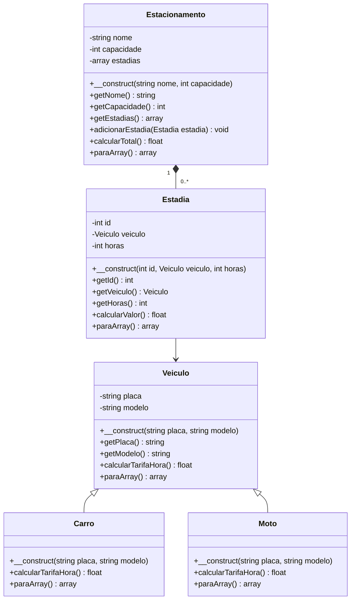

# Modelagem do estacionamento

## Objetivo e escopo

O sistema registra estadias de carros e motos, calcula o valor de cada
estadia e apresenta o valor total das estadias registradas.

A duração é informada em horas inteiras positivas. Não há cálculo
automático entre datas e horários.

Nesta versão, cada estadia registrada representa uma vaga ocupada.
Não há encerramento de estadias nem liberação de vagas.

## Regras de negócio

1. A placa do veículo não pode estar vazia ou conter somente espaços.
2. A duração da estadia deve ser maior que zero.
3. O estacionamento não pode receber uma nova estadia quando estiver lotado.
4. O identificador da estadia deve ser maior que zero.

Cada recusa será implementada com `throw new Exception(...)` e
tratada com `try/catch` no formulário e nos testes.

## Tarifas

- Carro: R$ 5,00 por hora.
- Moto: R$ 3,00 por hora.

O valor da estadia é a quantidade de horas multiplicada pela tarifa
do veículo. O valor total do estacionamento é a soma dos valores
das estadias registradas.

## Diagrama de classes

## Justificativas

### Herança e sobrescrita

Carro e Moto herdam de Veiculo porque um carro é um veículo e uma moto
também é um veículo. Placa e modelo são características comuns,
inicializadas pelo construtor da classe mãe com parent::__construct.

As classes filhas sobrescrevem calcularTarifaHora() para retornar a
tarifa de cada tipo. Também sobrescrevem paraArray() para acrescentar
a identificação do tipo de veículo aos dados comuns.

### Polimorfismo

Um foreach percorrerá uma lista contendo objetos Carro e Moto e chamará
calcularTarifaHora() em cada objeto.

A chamada será a mesma, mas o valor retornado dependerá da classe
do objeto: R$ 5,00 para carro e R$ 3,00 para moto.

Estadia também utilizará calcularTarifaHora() sem precisar escolher
a tarifa com condicionais baseadas no tipo de veículo.

### Composição

Estacionamento mantém uma lista de objetos Estadia. O método
adicionarEstadia() inclui uma estadia respeitando a capacidade,
e calcularTotal() soma os valores da lista.

A relação é de composição porque o estacionamento tem estadias,
e não porque um estacionamento é uma estadia. No escopo do sistema,
essas estadias pertencem ao estacionamento.

Cada Estadia também mantém uma referência ao Veiculo correspondente.

### Encapsulamento

Todos os atributos serão privados. Getters permitirão consultar os
dados necessários.

Não haverá setters nesta versão. Os dados serão definidos pelos
construtores, e a lista de estadias será modificada pelo método
adicionarEstadia(), que verificará a capacidade.

### Identificação e JSON

Cada estadia terá um identificador inteiro positivo e único,
atribuído pela camada de criação dos objetos. Ele permitirá
selecionar uma estadia na página de detalhes.

Todas as classes terão paraArray(). Os objetos relacionados serão
convertidos em arrays antes da geração do JSON com json_encode().